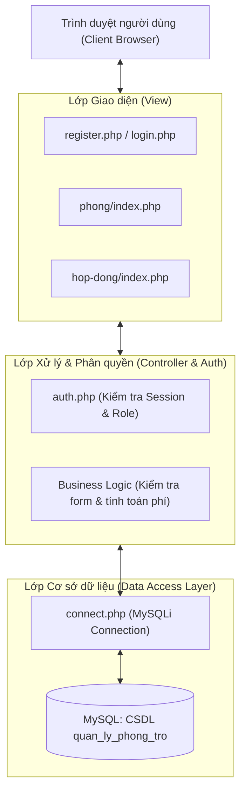
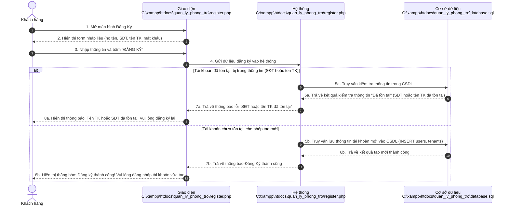
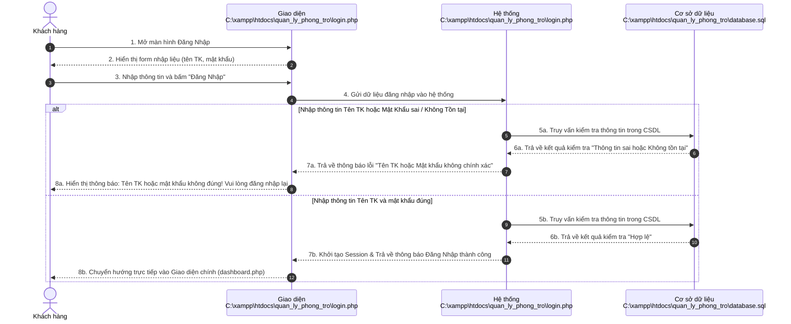
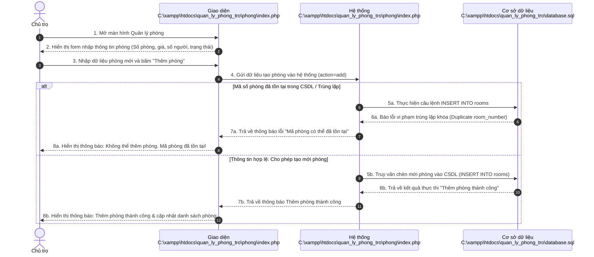
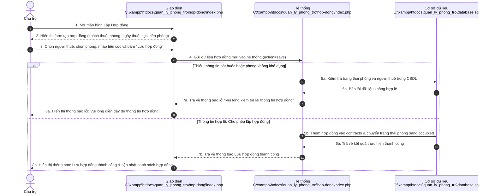
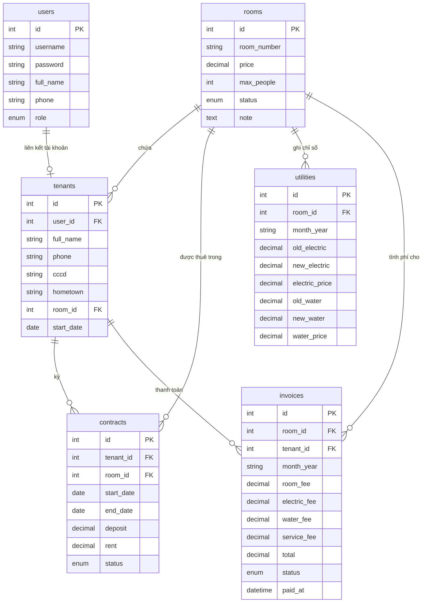

# BÁO CÁO GIỮA KỲ HỌC PHẦN CÔNG NGHỆ PHẦN MỀM

**ĐỀ TÀI: XÂY DỰNG HỆ THỐNG QUẢN LÝ PHÒNG TRỌ (TRỌ MANAGER)**  
**Học phần:** Công nghệ phần mềm (CNPM)  
**Môi trường thực nghiệm:** XAMPP / PHP & MySQL  
**Thư mục dự án:** `C:\xampp\htdocs\quan_ly_phong_tro`  

---

# MỤC LỤC

- [MỤC LỤC](#mục-lục)
- [CHƯƠNG 1: TỔNG QUAN CƠ SỞ LÝ THUYẾT](#chương-1-tổng-quan-cơ-sở-lý-thuyết)
  - [1.1. Giới thiệu bài toán và mục tiêu hệ thống](#11-giới-thiệu-bài-toán-và-mục-tiêu-hệ-thống)
  - [1.2. Ngôn ngữ lập trình áp dụng](#12-ngôn-ngữ-lập-trình-áp-dụng)
    - [1.2.1. PHP (Hypertext Preprocessor)](#121-php-hypertext-preprocessor)
    - [1.2.2. HTML5, CSS3 và JavaScript](#122-html5-css3-và-javascript)
  - [1.3. Hệ quản trị cơ sở dữ liệu (DBMS)](#13-hệ-quản-trị-cơ-sở-dữ-liệu-dbms)
  - [1.4. Công cụ (Tools) và Môi trường phát triển hỗ trợ](#14-công-cụ-tools-và-môi-trường-phát-triển-hỗ-trợ)
  - [1.5. Kiến trúc phần mềm áp dụng trong dự án](#15-kiến-trúc-phần-mềm-áp-dụng-trong-dự-án)
- [CHƯƠNG 2: THỰC NGHIỆM VÀ ĐẶC TẢ HỆ THỐNG](#chương-2-thực-nghiệm-và-đặc-tả-hệ-thống)
  - [2.1. Sơ đồ tuần tự (Sequence Diagram)](#21-sơ-đồ-tuần-tự-sequence-diagram)
    - [2.1.1. Sơ đồ tuần tự chức năng Đăng ký](#211-sơ-đồ-tuần-tự-chức-năng-đăng-ký)
    - [2.1.2. Sơ đồ tuần tự chức năng Đăng nhập](#212-sơ-đồ-tuần-tự-chức-năng-đăng-nhập)
    - [2.1.3. Sơ đồ tuần tự chức năng Tự chọn 1: Thêm phòng trọ mới](#213-sơ-đồ-tuần-tự-chức-năng-tự-chọn-1-thêm-phòng-trọ-mới)
    - [2.1.4. Sơ đồ tuần tự chức năng Tự chọn 2: Lập hợp đồng thuê trọ](#214-sơ-đồ-tuần-tự-chức-năng-tự-chọn-2-lập-hợp-đồng-thuê-trọ)
  - [2.2. Sơ đồ PERT (PERT Chart) & Phương pháp đường găng (Critical Path Method)](#22-sơ-đồ-pert-pert-chart--phương-pháp-đường-găng-critical-path-method)
    - [2.2.1. Bảng phân rã công việc (WBS) và ước lượng thời gian](#221-bảng-phân-rã-công-việc-wbs-và-ước-lượng-thời-gian)
    - [2.2.2. Bảng tính toán các chỉ số thời gian (ES, EF, LS, LF, Slack)](#222-bảng-tính-toán-các-chỉ-số-thời-gian-es-ef-ls-lf-slack)
    - [2.2.3. Sơ đồ mạng PERT/CPM và Xác định đường găng](#223-sơ-đồ-mạng-pertcpm-và-xác-định-đường-găng)
  - [2.3. Demo các chức năng hệ thống](#23-demo-các-chức-năng-hệ-thống)
    - [2.3.1. Giao diện & Thiết kế chức năng Đăng ký](#231-giao-diện--thiết-kế-chức-năng-đăng-ký)
    - [2.3.2. Giao diện & Thiết kế chức năng Đăng nhập](#232-giao-diện--thiết-kế-chức-năng-đăng-nhập)
    - [2.3.3. Giao diện & Thiết kế chức năng Tự chọn 1: Quản lý phòng trọ](#233-giao-diện--thiết-kế-chức-năng-tự-chọn-1-quản-lý-phòng-trọ)
    - [2.3.4. Giao diện & Thiết kế chức năng Tự chọn 2: Quản lý hợp đồng](#234-giao-diện--thiết-kế-chức-năng-tự-chọn-2-quản-lý-hợp-đồng)
  - [2.4. Dữ liệu (Database)](#24-dữ-liệu-database)
    - [2.4.1. Thiết kế lược đồ quan hệ CSDL](#241-thiết-kế-lược-đồ-quan-hệ-csdl)
    - [2.4.2. Chi tiết các bảng dữ liệu trong CSDL quan_ly_phong_tro](#242-chi-tiết-các-bảng-dữ-liệu-trong-csdl-quan_ly_phong_tro)
    - [2.4.3. Tập dữ liệu thực nghiệm (Sample Data)](#243-tập-dữ-liệu-thực-nghiệm-sample-data)
- [KẾT LUẬN VÀ HƯỚNG PHÁT TRIỂN](#kết-luận-và-hướng-phát-triển)

---

# CHƯƠNG 1: TỔNG QUAN CƠ SỞ LÝ THUYẾT

## 1.1. Giới thiệu bài toán và mục tiêu hệ thống
Trong công tác quản lý nhà trọ truyền thống, người chủ trọ thường ghi chép thủ công bằng sổ sách hoặc bảng tính Excel rời rạc. Cách làm này dẫn đến nhiều bất cập:
- Dễ thất lạc thông tin người thuê, ngày bắt đầu thuê và tình trạng phòng trống/đang thuê.
- Nhầm lẫn khi chốt chỉ số điện, nước định kỳ hàng tháng.
- Quản lý công nợ hóa đơn khó khăn, thiếu minh bạch đối với khách thuê.

**Hệ thống Quản lý phòng trọ (Trọ Manager)** được xây dựng nhằm tin học hóa toàn diện quy trình vận hành nhà trọ, phục vụ 3 nhóm đối tượng:
1. **Chủ trọ (Landlord)**: Quản lý toàn bộ danh mục phòng, khách thuê, hợp đồng, nhập chỉ số điện nước, lập và duyệt hóa đơn thu tiền, quản lý tài khoản nhân viên.
2. **Nhân viên (Staff)**: Hỗ trợ kiểm tra phòng, nhập chỉ số điện nước, lập phiếu thu hóa đơn.
3. **Người thuê (Tenant)**: Tra cứu hợp đồng cá nhân, theo dõi số điện nước tiêu thụ và hóa đơn hàng tháng.

---

## 1.2. Ngôn ngữ lập trình áp dụng

### 1.2.1. PHP (Hypertext Preprocessor)
- **Phiên bản:** PHP 8.x chạy trên môi trường XAMPP.
- **Đặc tính kỹ thuật áp dụng:**
  - **Phiên làm việc (Session Management):** Sử dụng `session_start()` để duy trì trạng thái đăng nhập của người dùng qua mảng `$_SESSION['user']`.
  - **Bảo mật mật khẩu:** Áp dụng hàm `password_hash($password, PASSWORD_DEFAULT)` chuẩn thuật toán Bcrypt để mã hóa mật khẩu trước khi lưu vào CSDL, và dùng `password_verify()` để đối soát khi đăng nhập.
  - **Prepared Statements (Chống SQL Injection):** Mọi thao tác truy vấn động đều sử dụng cơ chế `$conn->prepare()` và `$stmt->bind_param()` của thư viện MySQLi, đảm bảo an toàn dữ liệu tuyệt đối trước các cuộc tấn công SQL Injection.
  - **Giao dịch an toàn (Database Transactions):** Sử dụng `$conn->begin_transaction()`, `$conn->commit()` và `$conn->rollback()` tại các luồng tạo mới tài khoản kết hợp tạo hồ sơ khách thuê để chống phân mảnh dữ liệu.

### 1.2.2. HTML5, CSS3 và JavaScript
- **HTML5:** Cung cấp cấu trúc ngữ nghĩa (`<header>`, `<main>`, `<aside>`, `<section>`, `<form>`) giúp giao diện mạch lạc, thân thiện chuẩn SEO và trợ năng.
- **CSS3:** Xây dựng giao diện responsive theo kiến trúc hiện đại:
  - Hệ thống lưới CSS Grid (`grid-template-columns: repeat(auto-fit, minmax(...))`) và Flexbox.
  - Bảng màu quản trị chuẩn mực (`#2563eb`, `#1e293b`, `#f8fafc`, trạng thái màu badge: `#dcfce7` xanh lá cho phòng trống, `#dbeafe` xanh dương cho đang thuê, `#fef3c7` cam cho đang sửa).
- **JavaScript:** Xác thực tính hợp lệ của dữ liệu phía máy khách (Client-side validation) và hiển thị hộp thoại xác nhận khi xóa phòng, hủy hợp đồng.

---

## 1.3. Hệ quản trị cơ sở dữ liệu (DBMS)
- **Hệ thống:** **MySQL** (MariaDB tích hợp trong XAMPP Server).
- **Cơ sở dữ liệu:** `quan_ly_phong_tro`.
- **Bảng mã (Collation):** `utf8mb4_unicode_ci` hỗ trợ lưu trữ tiếng Việt có dấu đầy đủ và chính xác.
- **Công cụ quản trị:** phpMyAdmin và kết nối qua cổng mạng cục bộ `127.0.0.1:3307` (hoặc `3306`).
- **Toàn vẹn dữ liệu:** Ràng buộc khóa ngoại (`FOREIGN KEY`) kết hợp các luật `ON DELETE CASCADE` và `ON DELETE SET NULL`, đảm bảo tính nhất quán giữa danh mục phòng, khách thuê, hợp đồng và hóa đơn.

---

## 1.4. Công cụ (Tools) và Môi trường phát triển hỗ trợ

| Tên công cụ / Nền tảng | Phiên bản / Môi trường | Vai trò trong dự án |
| :--- | :--- | :--- |
| **XAMPP Control Panel** | v3.3.0 | Cung cấp Web Server Apache và máy chủ CSDL MySQL phục vụ chạy thử nghiệm cục bộ. |
| **Visual Studio Code** | v1.9x (Windows 64-bit) | Môi trường lập trình (IDE), quản lý mã nguồn, viết code PHP, HTML, CSS. |
| **draw.io (diagrams.net)** | Web / Desktop | Thiết kế sơ đồ kiến trúc, sơ đồ ca sử dụng (Use Case), sơ đồ tuần tự (Sequence Diagram). |
| **PlantUML** | Tiện ích tích hợp | Sinh biểu đồ tuần tự tự động từ mã kịch bản đồ họa theo chuẩn UML 2.0. |
| **Google Chrome / DevTools**| Phiên bản mới nhất | Kiểm thử hiển thị giao diện đa màn hình, kiểm tra network request và cookie/session. |

---

## 1.5. Kiến trúc phần mềm áp dụng trong dự án
Hệ thống được thiết kế theo mô hình phân lớp hướng Web (Layered Web Architecture):
1. **Lớp Giao diện (Presentation Layer - View):**
   - Các file PHP đóng vai trò View hiển thị HTML trực tiếp: `login.php`, `register.php`, `phong/index.php`, `hop-dong/index.php`, `hoa-don/index.php`.
2. **Lớp Xử lý nghiệp vụ & Điều hướng (Business & Controller Layer):**
   - File xác thực phân quyền `auth.php`: hàm `role_label()`, `require_roles()`, điều khiển thanh điều hướng `sidebar()`.
   - Các khối lệnh kiểm tra điều kiện đầu vào, xử lý sự kiện `POST`, mã hóa dữ liệu tại đầu mỗi trang.
3. **Lớp Dữ liệu (Data Access Layer):**
   - File kết nối tập trung `connect.php` khởi tạo đối tượng `$conn = new mysqli(...)`.
   - Toàn bộ câu lệnh SQL thực thi trực tiếp trên các bảng của `database.sql`.



---

# CHƯƠNG 2: THỰC NGHIỆM VÀ ĐẶC TẢ HỆ THỐNG

## 2.1. Sơ đồ tuần tự (Sequence Diagram)
Theo đúng quy chuẩn thiết kế bài tập lớn môn Công nghệ phần mềm, mỗi biểu đồ tuần tự được cấu thành từ 4 đối tượng tương tác:
- **Tác tử (Actor):** Khách hàng / Chủ trọ.
- **Giao diện (Boundary UI):** Đường dẫn file view vật lý trong thư mục dự án.
- **Hệ thống (Controller Logic):** Đường dẫn file PHP thực thi xử lý nghiệp vụ.
- **Cơ sở dữ liệu (Database):** Tệp kịch bản `database.sql` và bảng lưu trữ.

---

### 2.1.1. Sơ đồ tuần tự chức năng Đăng ký

- **Giao diện:** `C:\xampp\htdocs\quan_ly_phong_tro\register.php`
- **Hệ thống:** `C:\xampp\htdocs\quan_ly_phong_tro\register.php`
- **Cơ sở dữ liệu:** `C:\xampp\htdocs\quan_ly_phong_tro\database.sql` (bảng `users`, `tenants`)



---

### 2.1.2. Sơ đồ tuần tự chức năng Đăng nhập

- **Giao diện:** `C:\xampp\htdocs\quan_ly_phong_tro\login.php`
- **Hệ thống:** `C:\xampp\htdocs\quan_ly_phong_tro\login.php`
- **Cơ sở dữ liệu:** `C:\xampp\htdocs\quan_ly_phong_tro\database.sql` (bảng `users`)



---

### 2.1.3. Sơ đồ tuần tự chức năng Tự chọn 1: Thêm phòng trọ mới

- **Giao diện:** `C:\xampp\htdocs\quan_ly_phong_tro\phong\index.php`
- **Hệ thống:** `C:\xampp\htdocs\quan_ly_phong_tro\phong\index.php`
- **Cơ sở dữ liệu:** `C:\xampp\htdocs\quan_ly_phong_tro\database.sql` (bảng `rooms`)



---

### 2.1.4. Sơ đồ tuần tự chức năng Tự chọn 2: Lập hợp đồng thuê trọ

- **Giao diện:** `C:\xampp\htdocs\quan_ly_phong_tro\hop-dong\index.php`
- **Hệ thống:** `C:\xampp\htdocs\quan_ly_phong_tro\hop-dong\index.php`
- **Cơ sở dữ liệu:** `C:\xampp\htdocs\quan_ly_phong_tro\database.sql` (bảng `contracts`, `rooms`, `tenants`)



---

## 2.2. Sơ đồ PERT (PERT Chart) & Phương pháp đường găng (Critical Path Method)

### 2.2.1. Bảng phân rã công việc (WBS) và ước lượng thời gian
Áp dụng công thức ước lượng thời gian kỳ vọng của mô hình PERT:
$$T_e = \frac{a + 4m + b}{6}$$
Trong đó:
- $a$: Thời gian lạc quan nhất (Optimistic time).
- $m$: Thời gian có khả năng nhất (Most likely time).
- $b$: Thời gian bi quan nhất (Pessimistic time).

| Mã CV | Tên công việc chi tiết | Tiên quyết | $a$ | $m$ | $b$ | $T_e$ (ngày) |
| :---: | :--- | :---: | :---: | :---: | :---: | :---: |
| **A** | Khảo sát bài toán, xác định yêu cầu hệ thống | — | 2 | 3 | 4 | **3** |
| **B** | Phân tích yêu cầu, xây dựng Use Case & kịch bản | A | 3 | 4 | 5 | **4** |
| **C** | Thiết kế Cơ sở dữ liệu (ERD, cấu trúc bảng) | B | 3 | 4 | 5 | **4** |
| **D** | Thiết kế giao diện khung (UI Wireframe / Layout) | B | 2 | 3 | 4 | **3** |
| **E** | Cài đặt CSDL và kết nối (`database.sql`, `connect.php`) | C | 1 | 2 | 3 | **2** |
| **F** | Lập trình module Xác thực & Phân quyền (`auth`, `login`, `register`) | D, E | 4 | 5 | 6 | **5** |
| **G** | Lập trình module Quản lý phòng trọ (`phong/index.php`) | F | 3 | 4 | 5 | **4** |
| **H** | Lập trình module Người thuê & Hợp đồng (`hop-dong`, `nguoi-thue`) | F | 4 | 5 | 6 | **5** |
| **I** | Lập trình module Điện nước & Hóa đơn (`dien-nuoc`, `hoa-don`) | G, H | 3 | 4 | 5 | **4** |
| **J** | Kiểm thử tích hợp (Integration Test) & Sửa lỗi (Fix bug) | I | 2 | 3 | 4 | **3** |
| **K** | Đóng gói sản phẩm và hoàn thiện báo cáo đồ án | J | 1 | 2 | 3 | **2** |

---

### 2.2.2. Bảng tính toán các chỉ số thời gian (ES, EF, LS, LF, Slack)
Quy tắc tính toán CPM:
- **Tiến trình xuôi (Forward Pass):**  
  $$ES = \max(EF_{\text{tiên quyết}}), \quad EF = ES + T_e$$
- **Tiến trình ngược (Backward Pass):**  
  $$LF = \min(LS_{\text{kế nhiệm}}), \quad LS = LF - T_e$$
- **Thời gian dự trữ (Slack / Float):**  
  $$\text{Slack} = LS - ES = LF - EF$$
- **Công việc găng (Critical Activity):** Công việc có $\text{Slack} = 0$.

| Mã CV | Thời gian ($T_e$) | Thời điểm sớm ($ES$) | Thời điểm sớm ($EF$) | Thời điểm muộn ($LS$) | Thời điểm muộn ($LF$) | Độ dự trữ ($\text{Slack}$) | Công việc găng? |
| :---: | :---: | :---: | :---: | :---: | :---: | :---: | :---: |
| **A** | 3 | 0 | 3 | 0 | 3 | 0 | **Có (Găng)** |
| **B** | 4 | 3 | 7 | 3 | 7 | 0 | **Có (Găng)** |
| **C** | 4 | 7 | 11 | 7 | 11 | 0 | **Có (Găng)** |
| **D** | 3 | 7 | 10 | 10 | 13 | 3 | Không |
| **E** | 2 | 11 | 13 | 11 | 13 | 0 | **Có (Găng)** |
| **F** | 5 | 13 | 18 | 13 | 18 | 0 | **Có (Găng)** |
| **G** | 4 | 18 | 22 | 19 | 23 | 1 | Không |
| **H** | 5 | 18 | 23 | 18 | 23 | 0 | **Có (Găng)** |
| **I** | 4 | 23 | 27 | 23 | 27 | 0 | **Có (Găng)** |
| **J** | 3 | 27 | 30 | 27 | 30 | 0 | **Có (Găng)** |
| **K** | 2 | 30 | 32 | 30 | 32 | 0 | **Có (Găng)** |

---

### 2.2.3. Sơ đồ mạng PERT/CPM và Xác định đường găng

- **Tổng thời gian hoàn thành dự án tối thiểu:** **32 ngày**.
- **Đường găng (Critical Path):**  
  $$\mathbf{A \rightarrow B \rightarrow C \rightarrow E \rightarrow F \rightarrow H \rightarrow I \rightarrow J \rightarrow K}$$

```mermaid
flowchart LR
    classDef critical fill:#ffcccc,stroke:#b85450,stroke-width:2px,font-weight:bold;
    classDef noncritical fill:#e1f5fe,stroke:#0288d1,stroke-width:1px;

    Start((Bắt đầu)) --> A["A: Khảo sát (3d)"]
    A --> B["B: Phân tích Use Case (4d)"]
    
    B --> C["C: Thiết kế CSDL (4d)"]
    B --> D["D: Thiết kế giao diện (3d)"]
    
    C --> E["E: Cài đặt CSDL (2d)"]
    
    D --> F["F: Module Xác thực (5d)"]
    E --> F
    
    F --> G["G: Quản lý phòng (4d)"]
    F --> H["H: Người thuê & Hợp đồng (5d)"]
    
    G --> I["I: Điện nước & Hóa đơn (4d)"]
    H --> I
    
    I --> J["J: Kiểm thử & Sửa lỗi (3d)"]
    J --> K["K: Đóng gói & Báo cáo (2d)"]
    K --> End((Hoàn thành: 32 ngày))

    class A,B,C,E,F,H,I,J,K critical;
    class D,G noncritical;
```



---

## 2.3. Demo các chức năng hệ thống
Mỗi chức năng dưới đây được trình bày chuẩn hóa theo phương pháp **3/5 bước thiết kế kỹ thuật** kết hợp **Kết quả thực hiện thực tế**.

---

### 2.3.1. Giao diện & Thiết kế chức năng Đăng ký

#### Bước 1: Đặc tả yêu cầu & luồng xử lý
- Cho phép khách thuê tự mở tài khoản vào hệ thống.
- Yêu cầu nhập: Họ tên, Số điện thoại, Tên đăng nhập, Mật khẩu, Nhập lại mật khẩu.
- Hệ thống tự động gán quyền `role = 'tenant'`. Khi đăng ký thành công, thông tin được tự động tạo đồng thời ở 2 bảng `users` và `tenants`.

#### Bước 2: Thiết kế giao diện & các trường dữ liệu
- File giao diện: `register.php`.
- Bố cục: Form đặt trong thẻ `<div class="auth-card reg">`, định dạng CSS Grid chia 2 cột cho các trường họ tên, số điện thoại, tài khoản, mật khẩu. Có kiểm tra mật khẩu khớp và thông báo màu đỏ (lỗi) hoặc màu xanh (thành công).

#### Bước 3: Thiết kế câu lệnh truy vấn dữ liệu (SQL)
- Kiểm tra số điện thoại bị trùng:
  ```sql
  SELECT id FROM users WHERE phone = ? 
  UNION 
  SELECT id FROM tenants WHERE phone = ? LIMIT 1;
  ```
- Thêm người dùng và khách thuê mới bằng Transaction:
  ```sql
  INSERT INTO users(username, password, full_name, phone, role) VALUES(?, ?, ?, ?, 'tenant');
  INSERT INTO tenants(user_id, full_name, phone) VALUES(?, ?, ?);
  ```

#### Kết quả thực hiện thực tế:
- **Thử nghiệm hợp lệ:** Nhập đầy đủ thông tin $\rightarrow$ Hệ thống báo: *"Đăng ký tài khoản Người thuê thành công. Chủ trọ sẽ gán phòng/hợp đồng cho bạn."*
- **Thử nghiệm lỗi:** Nhập SĐT đã có $\rightarrow$ Hệ thống báo: *"Số điện thoại đã được sử dụng."*

---

### 2.3.2. Giao diện & Thiết kế chức năng Đăng nhập

#### Bước 1: Đặc tả yêu cầu & luồng xử lý
- Xác thực người dùng truy cập hệ thống. Hỗ trợ cả 3 đối tượng: Chủ trọ, Nhân viên, Người thuê.
- Kiểm tra tên đăng nhập và mật khẩu Bcrypt. Nếu đúng, lưu `$_SESSION['user']` và chuyển hướng đến `dashboard.php`.

#### Bước 2: Thiết kế giao diện & các trường dữ liệu
- File giao diện: `login.php`.
- Bố cục thẻ tập trung giữa màn hình (`login-box`), gồm logo biểu tượng `🏠`, nhãn hướng dẫn, ô nhập Tên đăng nhập/SĐT, ô nhập mật khẩu và nút Submit `ĐĂNG NHẬP`.

#### Bước 3: Thiết kế câu lệnh truy vấn dữ liệu (SQL)
```sql
SELECT id, username, password, full_name, role 
FROM users 
WHERE username = ? 
ORDER BY id;
```
Xác thực mật khẩu mã hóa trong PHP: `password_verify($password, $u['password'])`.

#### Kết quả thực hiện thực tế:
- **Thử nghiệm sai mật khẩu:** Báo lỗi viền đỏ: *"Tên đăng nhập hoặc mật khẩu không đúng!"*.
- **Thử nghiệm đúng:** Chuyển hướng ngay đến bảng điều khiển tổng quan (`dashboard.php`) với đúng quyền hạn tương ứng.

---

### 2.3.3. Giao diện & Thiết kế chức năng Tự chọn 1: Quản lý phòng trọ

#### Bước 1: Đặc tả yêu cầu & luồng xử lý
- Phân quyền: Chỉ `landlord` và `staff` được thêm, sửa, xóa phòng; `tenant` chỉ xem thông tin phòng của mình.
- Dữ liệu phòng gồm: Số phòng (bắt buộc, không trùng), Giá thuê/tháng, Số người tối đa, Trạng thái (Trống, Đang thuê, Đang sửa), Ghi chú.

#### Bước 2: Thiết kế giao diện & các trường dữ liệu
- File giao diện: `phong/index.php`.
- Phía trên là form `➕ Thêm phòng` (hoặc `✏️ Sửa phòng`), phía dưới là bảng danh sách phòng hiển thị dạng bảng dữ liệu có nhãn trạng thái (badge) đổi màu và các nút thao tác `Sửa`, `Xóa`.

#### Bước 3: Thiết kế câu lệnh truy vấn dữ liệu (SQL)
- Thêm mới phòng:
  ```sql
  INSERT INTO rooms(room_number, price, max_people, status, note) 
  VALUES(?, ?, ?, ?, ?);
  ```
- Truy vấn danh sách phòng kết hợp tìm kiếm:
  ```sql
  SELECT * FROM rooms WHERE room_number LIKE ? ORDER BY room_number;
  ```

#### Kết quả thực hiện thực tế:
- Bảng quản lý hiển thị rõ danh sách các phòng `P101`, `P102`, `P103`, giá thuê theo định dạng VNĐ (ví dụ: `2.500.000 đ`), nhãn trạng thái trực quan và có thông báo xác nhận an toàn trước khi xóa.

---

### 2.3.4. Giao diện & Thiết kế chức năng Tự chọn 2: Quản lý hợp đồng

#### Bước 1: Đặc tả yêu cầu & luồng xử lý
- Tạo lập hợp đồng giữa chủ trọ và người thuê.
- Khi một hợp đồng mới được kích hoạt (`status = 'active'`), hệ thống tự động cập nhật trạng thái phòng tương ứng sang `occupied` (Đang thuê).

#### Bước 2: Thiết kế giao diện & các trường dữ liệu
- File giao diện: `hop-dong/index.php`.
- Form nhập gồm: Chọn người thuê (từ bảng `tenants`), Chọn phòng còn trống (từ bảng `rooms`), Ngày bắt đầu, Ngày kết thúc, Tiền cọc, Tiền thuê hàng tháng, Trạng thái hợp đồng.

#### Bước 3: Thiết kế câu lệnh truy vấn dữ liệu (SQL)
```sql
INSERT INTO contracts(tenant_id, room_id, start_date, end_date, deposit, rent, status)
VALUES(?, ?, ?, ?, ?, ?, ?);

UPDATE rooms SET status = 'occupied' WHERE id = ?;
```

#### Kết quả thực hiện thực tế:
- Hợp đồng được lưu đầy đủ vào CSDL, phòng chuyển sang trạng thái đã thuê; người thuê khi đăng nhập vào hệ thống sẽ thấy hợp đồng của mình xuất hiện tại giao diện cá nhân.

---

## 2.4. Dữ liệu (Database)

### 2.4.1. Thiết kế lược đồ quan hệ CSDL
Cơ sở dữ liệu `quan_ly_phong_tro` gồm 6 bảng thực thể liên kết chặt chẽ:
- `users`: Tài khoản đăng nhập hệ thống.
- `tenants`: Hồ sơ người thuê (liên kết 1-1 với `users` và N-1 với `rooms`).
- `rooms`: Danh mục phòng trọ.
- `contracts`: Hợp đồng thuê phòng (liên kết N-1 với `tenants` và `rooms`).
- `utilities`: Chỉ số điện nước hàng tháng theo phòng (liên kết N-1 với `rooms`).
- `invoices`: Hóa đơn tiền trọ hàng tháng (liên kết N-1 với `rooms` và `tenants`).



---

### 2.4.2. Chi tiết các bảng dữ liệu trong CSDL quan_ly_phong_tro

#### 1. Bảng `users` (Quản lý người dùng)
| Trường | Kiểu dữ liệu | Khóa / Ràng buộc | Mô tả |
| :--- | :--- | :---: | :--- |
| `id` | INT | PRIMARY KEY, AUTO_INCREMENT | Mã định danh người dùng |
| `username` | VARCHAR(50) | NOT NULL | Tên tài khoản đăng nhập |
| `password` | VARCHAR(255)| NOT NULL | Mật khẩu băm (Bcrypt hash) |
| `full_name` | VARCHAR(100)| NOT NULL | Họ và tên hiển thị |
| `phone` | VARCHAR(20) | UNIQUE, NULL | Số điện thoại liên lạc |
| `role` | ENUM | DEFAULT 'staff' | Quyền: `'landlord'`, `'staff'`, `'tenant'` |
| `created_at`| TIMESTAMP | DEFAULT CURRENT_TIMESTAMP | Thời điểm tạo tài khoản |

#### 2. Bảng `rooms` (Quản lý phòng trọ)
| Trường | Kiểu dữ liệu | Khóa / Ràng buộc | Mô tả |
| :--- | :--- | :---: | :--- |
| `id` | INT | PRIMARY KEY, AUTO_INCREMENT | Mã phòng |
| `room_number`| VARCHAR(20)| UNIQUE, NOT NULL | Số hiệu phòng (P101, P102...) |
| `price` | DECIMAL(12,2)| NOT NULL, DEFAULT 0 | Giá thuê cơ sở hàng tháng |
| `max_people` | INT | DEFAULT 2 | Số người ở tối đa |
| `status` | ENUM | DEFAULT 'empty' | Tình trạng: `'empty'`, `'occupied'`, `'repair'` |
| `note` | TEXT | NULL | Ghi chú thêm về tiện nghi, hiện trạng |

#### 3. Bảng `tenants` (Quản lý khách thuê)
| Trường | Kiểu dữ liệu | Khóa / Ràng buộc | Mô tả |
| :--- | :--- | :---: | :--- |
| `id` | INT | PRIMARY KEY, AUTO_INCREMENT | Mã khách thuê |
| `user_id` | INT | UNIQUE, FOREIGN KEY $\rightarrow$ `users(id)` | Liên kết tài khoản đăng nhập |
| `full_name` | VARCHAR(100)| NOT NULL | Họ tên người thuê |
| `phone` | VARCHAR(20) | UNIQUE | Số điện thoại |
| `cccd` | VARCHAR(20) | NULL | Căn cước công dân |
| `hometown` | VARCHAR(150)| NULL | Quê quán / Thường trú |
| `room_id` | INT | FOREIGN KEY $\rightarrow$ `rooms(id)` | Phòng đang ở hiện tại |
| `start_date`| DATE | NULL | Ngày bắt đầu vào ở |

#### 4. Bảng `contracts` (Hợp đồng thuê phòng)
| Trường | Kiểu dữ liệu | Khóa / Ràng buộc | Mô tả |
| :--- | :--- | :---: | :--- |
| `id` | INT | PRIMARY KEY, AUTO_INCREMENT | Mã hợp đồng |
| `tenant_id` | INT | FOREIGN KEY $\rightarrow$ `tenants(id)` | Khách thuê đại diện ký hợp đồng |
| `room_id` | INT | FOREIGN KEY $\rightarrow$ `rooms(id)` | Phòng thuê |
| `start_date`| DATE | NOT NULL | Ngày ký / Bắt đầu hợp đồng |
| `end_date` | DATE | NULL | Ngày hết hạn hợp đồng |
| `deposit` | DECIMAL(12,2)| DEFAULT 0 | Tiền đặt cọc giữ phòng |
| `rent` | DECIMAL(12,2)| DEFAULT 0 | Tiền thuê thỏa thuận trên hợp đồng |
| `status` | ENUM | DEFAULT 'active' | Trạng thái: `'active'`, `'expired'`, `'cancelled'` |

#### 5. Bảng `utilities` (Quản lý điện nước)
| Trường | Kiểu dữ liệu | Khóa / Ràng buộc | Mô tả |
| :--- | :--- | :---: | :--- |
| `id` | INT | PRIMARY KEY, AUTO_INCREMENT | Mã bản ghi |
| `room_id` | INT | FOREIGN KEY $\rightarrow$ `rooms(id)` | Phòng ghi điện nước |
| `month_year`| VARCHAR(7) | NOT NULL (VD: '2026-11') | Kỳ thu tiền (tháng/năm) |
| `old_electric`| DECIMAL(12,2)| DEFAULT 0 | Chỉ số điện cũ (kWh) |
| `new_electric`| DECIMAL(12,2)| DEFAULT 0 | Chỉ số điện mới (kWh) |
| `electric_price`| DECIMAL(12,2)| DEFAULT 3500 | Đơn giá điện (đ/kWh) |
| `old_water` | DECIMAL(12,2)| DEFAULT 0 | Chỉ số nước cũ ($m^3$) |
| `new_water` | DECIMAL(12,2)| DEFAULT 0 | Chỉ số nước mới ($m^3$) |
| `water_price`| DECIMAL(12,2)| DEFAULT 15000 | Đơn giá nước ($đ/m^3$) |

#### 6. Bảng `invoices` (Quản lý hóa đơn)
| Trường | Kiểu dữ liệu | Khóa / Ràng buộc | Mô tả |
| :--- | :--- | :---: | :--- |
| `id` | INT | PRIMARY KEY, AUTO_INCREMENT | Mã hóa đơn |
| `room_id` | INT | FOREIGN KEY $\rightarrow$ `rooms(id)` | Phòng phát hành hóa đơn |
| `tenant_id` | INT | FOREIGN KEY $\rightarrow$ `tenants(id)` | Người nhận thanh toán |
| `month_year`| VARCHAR(7) | NOT NULL | Kỳ hóa đơn |
| `room_fee` | DECIMAL(12,2)| DEFAULT 0 | Tiền phòng |
| `electric_fee`| DECIMAL(12,2)| DEFAULT 0 | Tiền điện tiêu thụ trong tháng |
| `water_fee` | DECIMAL(12,2)| DEFAULT 0 | Tiền nước tiêu thụ trong tháng |
| `service_fee`| DECIMAL(12,2)| DEFAULT 0 | Phí dịch vụ (rác, wifi, vệ sinh) |
| `total` | DECIMAL(12,2)| GENERATED STORED | Tổng tiền tự động tính |
| `status` | ENUM | DEFAULT 'unpaid' | Trạng thái: `'unpaid'`, `'paid'` |
| `paid_at` | DATETIME | NULL | Thời điểm thanh toán |

---

### 2.4.3. Tập dữ liệu thực nghiệm (Sample Data)
Dữ liệu mẫu khởi tạo trong file `database.sql` gồm:
- **Tài khoản quản trị viên (Chủ trọ):**
  - Username: `chutro` | Password mã hóa: `$2y$12$HFOoZiV1sn2ZJX2VfvUc2eFikVuZzQgHBMKfbYjCMe7hx0dM7cDry` (Mật khẩu gốc: `123456`) | Quyền: `landlord`.
- **Danh mục phòng thử nghiệm:**
  - `P101`: Giá 2.500.000 đ, tối đa 2 người, trạng thái: `occupied` (Đang thuê).
  - `P102`: Giá 2.500.000 đ, tối đa 2 người, trạng thái: `occupied` (Đang thuê).
  - `P103`: Giá 2.700.000 đ, tối đa 3 người, trạng thái: `empty` (Phòng trống).
  - `P104`: Giá 2.700.000 đ, tối đa 3 người, trạng thái: `repair` (Đang sửa chữa).
  - `P105`: Giá 3.000.000 đ, tối đa 4 người, trạng thái: `empty` (Phòng trống).
  - `P201`: Giá 2.500.000 đ, tối đa 2 người, trạng thái: `occupied` (Đang thuê).
  - `P202`: Giá 2.500.000 đ, tối đa 2 người, trạng thái: `empty` (Phòng trống).
  - `P203`: Giá 2.700.000 đ, tối đa 3 người, trạng thái: `occupied` (Đang thuê).

---

# KẾT LUẬN VÀ HƯỚNG PHÁT TRIỂN

## Kết quả đạt được
1. **Về mặt lý thuyết & thiết kế:** Đã hoàn thành đầy đủ phân tích yêu cầu, xây dựng sơ đồ tuần tự chuẩn xác theo kiến trúc 4 lớp tương tác, áp dụng thành công phương pháp PERT/CPM xác định đường găng 32 ngày đảm bảo tiến độ dự án.
2. **Về mặt thực nghiệm ứng dụng:** Đã xây dựng hoàn chỉnh mã nguồn hệ thống trên nền PHP & MySQL, vận hành trơn tru các chức năng cốt lõi: Đăng ký, Đăng nhập phân quyền, Quản lý danh mục phòng, Lập hợp đồng, Quản lý điện nước và Hóa đơn thanh toán.
3. **Về mặt cơ sở dữ liệu:** Thiết kế chuẩn hóa dạng chuẩn 3NF, ràng buộc khóa ngoại chặt chẽ, đảm bảo tính toàn vẹn và an toàn dữ liệu.

## Hướng phát triển trong giai đoạn cuối kỳ
- Tích hợp cổng thanh toán trực tuyến qua mã QR VietQR / MoMo tự động gạch nợ hóa đơn.
- Phát triển tính năng gửi thông báo tự động (Zalo / SMS / Email) khi có hóa đơn mới phát hành.
- Bổ sung biểu đồ thống kê trực quan doanh thu theo năm và tỷ lệ lấp đầy phòng.
